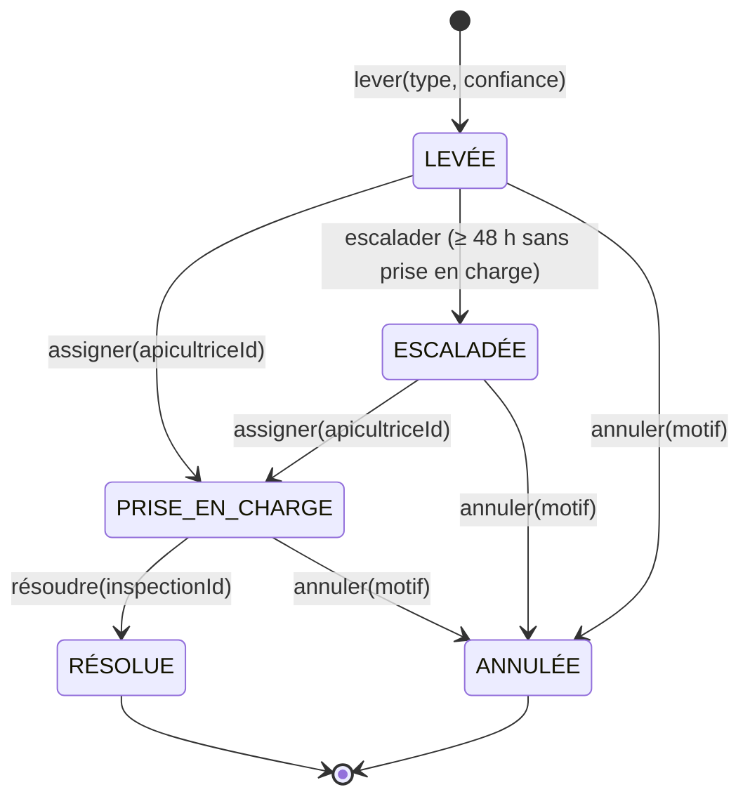
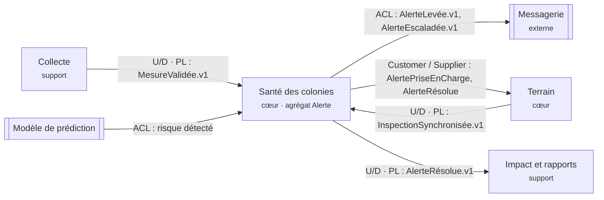

# Parcours Dev · Agrégat `Alerte` (contexte « Santé des colonies »)

## 1. Rôle de l'agrégat

Une `Alerte` est levée par le modèle de prédiction (UC-A02), prise en charge par une apicultrice ou un apiculteur (assignée par le coordinateur, UC-C01), puis résolue après une inspection (UC-A01). Sans prise en charge sous 48 h, elle est escaladée.

`Alerte` est la **racine** de l'agrégat. Elle est créée uniquement par la fabrique `Alerte.lever(...)`, et son statut ne change que par les méthodes métier `assigner`, `escalader` et `resoudre`. Elle ne référence les autres agrégats (ruche, inspection, apicultrice) que par leur identifiant (`hiveId`, `inspectionId`, `apicultriceId`).

## 2. Diagramme d'états



Chaque état est un objet (pattern **State**) qui implémente `assigner`, `escalader`, `resoudre` et `annuler`. L'agrégat délègue à l'état courant, donc il n'y a aucun `switch` sur le statut. Une transition illégale est une méthode qui lève une erreur.

| État | `assigner` | `escalader` | `resoudre` | `annuler` |
|---|---|---|---|---|
| LEVÉE | → PRISE_EN_CHARGE | → ESCALADÉE si ≥ 48 h, sinon refusé | refusé (prise en charge requise) | → ANNULÉE (motif exigé) |
| PRISE_EN_CHARGE | refusé (déjà prise en charge) | refusé | → RÉSOLUE (`inspectionId` exigé) | → ANNULÉE (motif exigé) |
| ESCALADÉE | → PRISE_EN_CHARGE | refusé (déjà escaladée) | refusé (prise en charge requise) | → ANNULÉE (motif exigé) |
| RÉSOLUE | refusé | refusé | refusé | refusé |
| ANNULÉE | refusé | refusé | refusé | refusé |

## 3. Invariants

| # | Invariant | Où il est garanti | Test |
|---|---|---|---|
| I1 | Le type de risque appartient à `ESSAIMAGE`, `AFFAIBLISSEMENT`, `STRESS_THERMIQUE`, `MORTALITE`. | `Alerte.lever()` | 2 |
| I2 | La confiance est un nombre fini compris entre 0 et 1. | `Alerte.lever()` | 3 |
| I3 | On ne résout pas une alerte qui n'a pas été prise en charge. | `Levee.resoudre`, `Escaladee.resoudre` | 5 |
| I4 | La résolution exige l'identifiant d'une inspection. | `PriseEnCharge.resoudre` | 6 |
| I5 | On n'escalade qu'une alerte restée LEVÉE depuis au moins 48 h (`>=`). | `Levee.escalader` via `estEnRetard()` | 7, 8 |
| I6 | Une alerte escaladée peut être prise en charge, mais pas escaladée une seconde fois. | `Escaladee` | 8 |
| I7 | Une alerte résolue n'accepte plus aucune transition. | `Resolue` | 9 |
| I9 | Une fausse alerte se signale avec un motif, et l'annulation est impossible une fois l'alerte résolue ; une alerte annulée est un état final. | `Annulee`, `annuler` de chaque état | B1 à B5 |
| I8 | Une transition = un changement d'état **et** un événement, de façon atomique. | `alerte._passer()` | 4, 6, 8 |

## 4. Événements publiés

Chaque événement porte `type`, `alerteId`, `hiveId`, `siteId` et `at` (ISO 8601, UTC).

| Événement | Déclencheur | Données propres |
|---|---|---|
| `AlerteLevée` | `lever()` | `siteId`, `risque`, `confiance` |
| `AlertePriseEnCharge` | `assigner()` (depuis LEVÉE ou ESCALADÉE) | `apicultriceId` |
| `AlerteEscaladée` | `escalader()` | n/a |
| `AlerteRésolue` | `resoudre()` | `inspectionId` |
| `AlerteAnnulée` | `annuler()` | `motif` |

Le service applicatif suit le schéma charger → agir → sauvegarder → publier. Les événements sont accumulés dans l'agrégat, puis consommés une seule fois par `pullEvents()` et émis sur l'`EventBus` (pattern **Observer**). La politique « quand une alerte reste 48 h sans prise en charge, alors l'escalader » vit dans `AlerteService.escaladerAlertesEnRetard()`. Elle est appelée par un déclencheur périodique, et l'agrégat reste ainsi indépendant du temps réel : l'heure est passée en paramètre (`at`, `now`).

## 5. Place sur la context map

L'agrégat vit dans le contexte **Santé des colonies** (cœur de domaine). Ce contexte publie les événements d'alerte, et ses voisins sont les suivants.



- **Qui publie `AlerteLevée` ?** Santé des colonies, quand le modèle de prédiction (système externe, derrière une couche anticorruption) signale un risque.
- **Qui consomme `AlerteEscaladée` ?** la messagerie (prévenir le coordinateur du site, puis le coordinateur régional, via une politique du contexte) et Terrain (replanifier la visite en priorité).
- **Qui consomme `AlerteRésolue` ?** Impact et rapports (indicateurs « colonies sauvées », délai de traitement).
- **Qui publie ce que consomme `resoudre()` ?** Terrain publie `InspectionSynchronisée`, dont l'identifiant arrive comme `inspectionId`. L'agrégat ne connaît que cet identifiant.

## 6. Résultats

```
$ npm run tp5          → tests 12 · pass 12 · fail 0
$ npm run lint:archi   → ✓ aucun fichier domain/ n'importe l'extérieur
$ node .../demo.js     → sortie identique à l'énoncé (ALR-001 résolue, ALR-002 escaladée puis prise en charge)
$ node --test .../alerte-bonus.test.js → tests 7 · pass 7 (ANNULÉE et observateur)
```

## 7. Options « pour aller plus loin » (réalisées)

- **État `ANNULÉE`** : `annuler(motif, at)` depuis LEVÉE, ESCALADÉE ou PRISE_EN_CHARGE, avec l'événement `AlerteAnnulée`. Depuis RÉSOLUE ou ANNULÉE, c'est refusé. Une alerte annulée sort de la politique des 48 h, car le service ne charge que les alertes `LEVÉE`. Tests B1 à B6 dans `alerte-bonus.test.js`.
- **Observateur de notification** : `adapters/NotificationCoordinateur.js` s'abonne à `AlerteEscaladée` sur le bus et prévient le coordinateur du site via un port `notifier`. Il vit dans les adaptateurs, jamais dans le domaine. Test B7.

## 8. Amorce de l'ADR de spécialité

**Où vit la politique d'escalade à 48 h ?**

| Option | Pour | Contre |
|---|---|---|
| Tâche planifiée (cron) qui appelle `escaladerAlertesEnRetard()` | Simple, testable avec l'horloge simulée | Précision limitée à la période du cron |
| File différée (message programmé à T+48 h à la levée) | Précis, un message par alerte | Annulation à gérer si l'alerte est prise en charge avant |
| Requête en base (vue ou trigger SQL) | Peu de code applicatif | Règle métier dispersée hors du domaine |

Piste de décision : tâche planifiée toutes les 15 min, car l'escalade à 48 h n'exige pas une précision à la seconde et la connectivité terrain est intermittente. Une alerte prise en charge entre-temps est écartée par le filtre `findByStatut('LEVÉE')`.

**Autre ADR possible** : comment l'application terrain hors ligne reçoit-elle les alertes (push, synchronisation au prochain accès, file locale) ?
